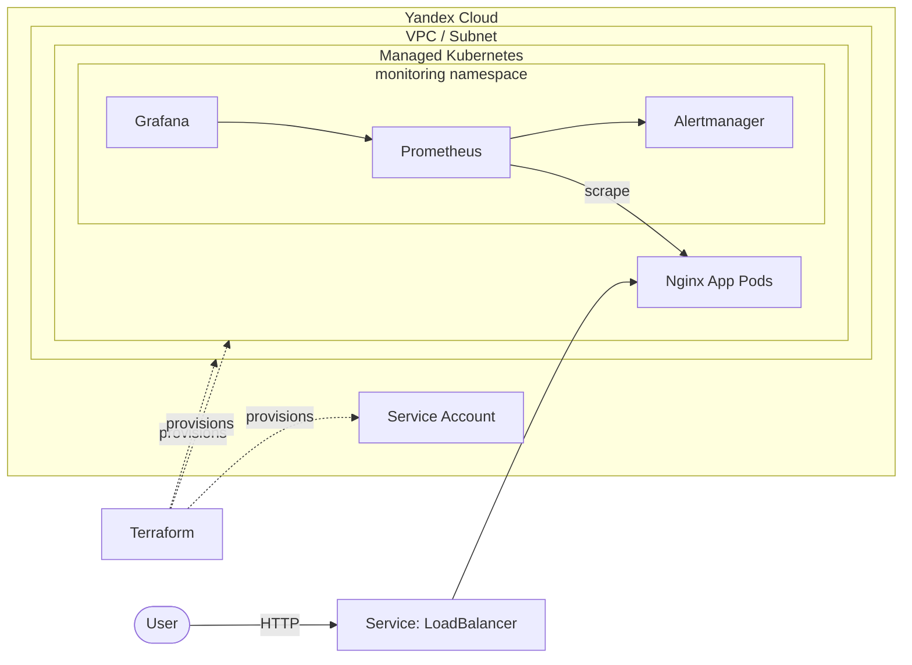

# infra-lab

End-to-end infrastructure demo: **Yandex Cloud** → **managed Kubernetes** → **Prometheus/Grafana monitoring** → **CI/CD** for a containerized app.

Built as a personal project to practice the full delivery loop — from cloud provisioning to a running, observable application.

---

## Architecture


---

- **Terraform** provisions the VPC, subnet, security groups and a managed Kubernetes cluster.
- **Nginx app** packaged into a Docker image, deployed via Kubernetes manifests.
- **kube-prometheus** stack provides Prometheus, Alertmanager and Grafana.
- **CI/CD** builds the image and updates the deployment on merge to `main`.

---

## Stack

| Layer            | Tools                                                  |
| ---------------- | ------------------------------------------------------ |
| Cloud            | Yandex Cloud (managed Kubernetes, VPC, Object Storage) |
| IaC              | Terraform                                              |
| Orchestration    | Kubernetes, Helm                                       |
| Containerization | Docker                                                 |
| Monitoring       | Prometheus, Grafana, Alertmanager (kube-prometheus)    |
| CI/CD            | GitHub Actions                                         |
| App              | Nginx serving a static page                            |

---

## Repository layout

```
.
├── terraform/           # infrastructure as code
│   ├── 01-sa-backend/   # service accounts and IAM
│   └── 02-kubernetes/   # VPC, cluster, security groups
├── app/                 # demo application
│   ├── Dockerfile
│   ├── index.html
│   ├── nginx.conf
│   └── k8s/             # Kubernetes manifests
├── monitoring/          # monitoring stack deployment
├── docs/                # additional documentation
└── README.md
```
---

## Prerequisites

- Terraform >= 1.5
- Yandex Cloud CLI (`yc`) authenticated
- `kubectl`
- Helm >= 3
- A Yandex Cloud account with a folder and billing enabled
---

## How to deploy

### 1. Configure credentials

```bash
export YC_TOKEN=$(yc iam create-token)
export YC_CLOUD_ID=$(yc config get cloud-id)
export YC_FOLDER_ID=$(yc config get folder-id)
```

### 2. Provision IAM

```bash
cd terraform/01-sa-backend
cp terraform.tfvars.example terraform.tfvars   # fill in your values
terraform init
terraform apply
```

### 3. Provision the cluster

```bash
cd ../02-kubernetes
cp terraform.tfvars.example terraform.tfvars
terraform init
terraform apply
yc managed-kubernetes cluster get-credentials --id $(terraform output -raw cluster_id) --external
kubectl get nodes
```

### 4. Build and deploy the app

```bash
docker build -t cr.yandex/<registry-id>/infra-lab-app:latest app/
docker push cr.yandex/<registry-id>/infra-lab-app:latest

kubectl apply -f app/k8s/deployment.yaml
kubectl apply -f app/k8s/service-lb.yaml
kubectl get svc -w    # wait for EXTERNAL-IP
```

### 5. Install monitoring

```bash
./monitoring/deploy-monitoring.sh
kubectl -n monitoring get pods
```

Grafana and Prometheus are exposed via `kubectl port-forward` by default (see `monitoring/README.md`).

### 6. Destroy

```bash
cd terraform/02-kubernetes && terraform destroy
cd ../01-sa-backend      && terraform destroy
```

> **Note:** a managed Kubernetes cluster costs money while it exists. This project is designed to be deployed for a demo, screenshotted, and destroyed.
---

## Security notes

- **No secrets in the repo.** All credentials are passed via environment variables or local `terraform.tfvars` (gitignored).
- Terraform state is **not** committed. For a real setup it would live in an S3-compatible backend with locking.
- Service accounts follow least privilege: separate SA for Terraform, separate SA for CI.
---

## What I'd improve next

- **Secrets management:** integrate External Secrets Operator or HashiCorp Vault instead of K8s Secrets.
- **SLOs and alerting:** define SLIs for the app, add burn-rate alerts on top of the existing Prometheus rules.
- **CI hardening:** add `terraform fmt -check`, `tflint`, `trivy` image scan and a `terraform plan` comment in PRs.
- **Autoscaling:** enable HPA for the app and cluster autoscaler for the node group.
---

## Background

Built as a personal deep-dive into production-like infrastructure after my DevOps course. The goal was not just to "make it work" but to structure the repo the way a real team would: IaC, reproducible steps, documented decisions, no secrets in Git.