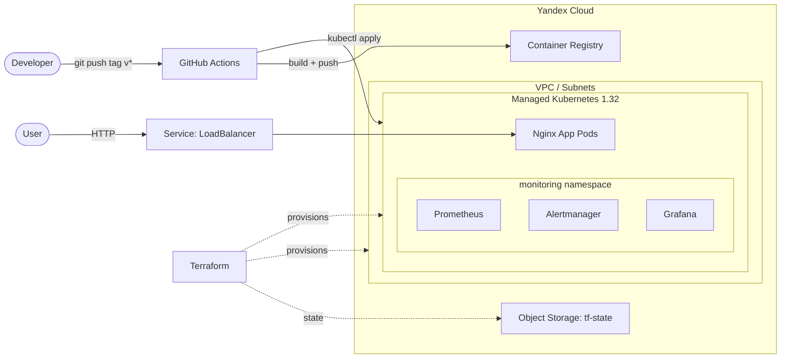

# infra-lab

End-to-end infrastructure demo: **Yandex Cloud** → **managed Kubernetes** → **Prometheus/Grafana monitoring** → **CI/CD** for a containerized app.

Pet project for practicing the full delivery loop — from cloud provisioning to a running, observable application.

---

## Architecture



---

- **Terraform** provisions the VPC, subnets, NAT gateway, security groups and a managed Kubernetes cluster.
- **Nginx app** packaged into a Docker image, deployed via Kustomize manifests.
- **kube-prometheus** provides Prometheus, Alertmanager and Grafana (installed as a git submodule).
- **CI/CD** builds the image on push to `master` and deploys on tags `v*`. 

---

## Stack

| Layer            | Tools                                                    |
| ---------------- | -------------------------------------------------------- |
| Cloud            | Yandex Cloud (managed Kubernetes, VPC, Object Storage)   |
| IaC              | Terraform (S3 backend, S3-native locking via versioning) |
| Orchestration    | Kubernetes 1.32, Kustomize                               |
| Containerization | Docker                                                   |
| Monitoring       | Prometheus, Grafana, Alertmanager (kube-prometheus)      |
| CI/CD            | GitHub Actions                                           |
| App              | Nginx serving a static page                              |

---

## Repository layout

```
.
├── .github/workflows/
│   ├── app-build.yml           # push to master: build+push :latest
│   ├── app-deploy.yml          # tag v*: build+push+deploy
│   ├── infra-kubernetes.yml    # PR/push: terraform plan/apply + tflint
│   └── monitoring.yml          # workflow_run after infra: deploy kube-prometheus
├── demo-app/
│   ├── app/                    # Dockerfile + nginx config + index.html
│   └── k8s/                    # Kubernetes manifests + kustomization
├── terraform-infrastructure/
│   ├── 01_sa_backend/          # bootstrap: SA, S3 bucket, registry, ci-cd-sa (manual)
│   ├── 02-kubernetes/          # VPC, cluster, node group, RBAC
│   ├── 03-monitoring/          # kube-prometheus as git submodule
│   ├── scripts/                # deploy-monitoring.sh, rotate-secrets, etc.
│   └── keys/                   # local secrets (gitignored)
├── docs/
│   ├── architecture.md
│   └── getting-kubeconfig.md
└── README.md
```

---

## Accounts & IAM

The project uses **5 service accounts** with clear separation of duties:

| Account | Created in | Purpose | Key roles |
|---|---|---|---|
| **bootstrap-SA** | Manually in console (`~/.authorized_key_m.json`) | Only the very first `terraform apply` in `01_sa_backend` | `admin` on folder |
| **`mlnstw-sa`** | `01_sa_backend` | Terraform operations in `02-kubernetes`; cluster-admin on the cluster | `k8s.admin`, `vpc.admin`, `storage.admin`, etc. |
| **`k8s-cluster-sa`** | `02-kubernetes` | Managed K8s control plane (creates load balancers for `Service type=LoadBalancer`) | `load-balancer.admin`, `vpc.admin`, `k8s.clusters.agent` |
| **`k8s-nodes-sa`** | `02-kubernetes` | Worker nodes (pull images from registry) | `container-registry.images.puller` |
| **`ci-cd-sa`** | `01_sa_backend` | GitHub Actions (push images, deploy to K8s) | `container-registry.images.pusher`, `k8s.viewer` (folder), `k8s.cluster-api.editor` (cluster) |

The `bootstrap-SA` is only used once — after `01_sa_backend` runs, everything else uses `mlnstw-sa` (for Terraform) or `ci-cd-sa` (for CI).

---

## Prerequisites

- Terraform >= 1.8
- Yandex Cloud CLI (`yc`) authenticated as a user with `admin` on the target folder
- `kubectl` (for local debugging, `kubectl get pods`, etc.)
- `gh` (GitHub CLI) — for managing secrets
- A Yandex Cloud account with a folder and billing enabled

---

## First-time setup (bootstrap)

### 1. Create bootstrap-SA in console

1. In Yandex Cloud console, create a service account (e.g. `bootstrap-sa`) with **`admin` on the folder**.
2. Create an **authorized key** (JSON) for it, save as `~/.authorized_key.json`.

---

### 2. Provision IAM, bucket, registry (manual — one time)

```bash
cd terraform-infrastructure/01_sa_backend

# Create personal.auto.tfvars with your values (this file is gitignored)
cat > personal.auto.tfvars <<EOF
cloud_id    = "your-cloud-id"
folder_id   = "your-folder-id"
bucket_name = "your-tf-state-bucket"
sa_name     = "mlnstw-sa"
generate_local_files = true
EOF

terraform init
terraform apply
```

This creates:
- SA `mlnstw-sa` with broad folder roles (used by all subsequent Terraform)
- S3 bucket for Terraform state (with versioning)
- Container Registry `mlnstw-registry`
- SA `ci-cd-sa` with `container-registry.images.pusher` + authorized key (`../keys/ci-cd-key.json`)
- SA `mlnstw-sa` static S3 access key (`../keys/access_key.txt`, `../keys/secret_key.txt`)
- Generated `../02-kubernetes/backend.tf` (committed to git, **no secrets**)

---

### 3. Add GitHub Secrets

```bash
gh auth login    # once
./scripts/rotation-secrets.sh
```

See *gh secret list* for the full list.

---

### 4. Apply Kubernetes infrastructure via CI

Create a PR to `master` touching `terraform-infrastructure/02-kubernetes/**`, or push directly. `infra-kubernetes.yml` runs:
- `terraform fmt -check`, `tflint`, `terraform validate`
- On PR: `terraform plan` (visible in logs)
- On push to `master`: `terraform apply`

---

### 4a. (Optional) Apply 02-kubernetes locally

CI is the recommended path. For local `terraform destroy` or debugging, you need three things:

**1. S3 credentials (env vars):**

```bash
cd terraform-infrastructure/01_sa_backend
eval "$(terraform output -raw keys)"     # sets AWS_ACCESS_KEY_ID + AWS_SECRET_ACCESS_KEY
cd ../02-kubernetes
```

**2. `my.auto.tfvars` (gitignored)** — local-only values:

```hcl
cloud_id                 = "your-cloud-id"
generate_local_files     = true
service_account_key_file = "../keys/terraform-key.json"
```

**3. Already in git:** `personal.auto.tfvars` (contains `folder_id` and `conf_subnet`) and `backend.tf` (generated by `01_sa_backend`, no secrets).

Then:

```bash
terraform init
terraform plan
```

**Common mistake:** don't duplicate `folder_id` in `my.auto.tfvars` — it's already in `personal.auto.tfvars`, which wins (loaded later). Only `cloud_id` and `service_account_key_file` are local-only.

---

### 5. Deploy monitoring

Automatically triggered by `workflow_run` after `infra-kubernetes.yml` succeeds. Or manually:

```bash
gh workflow run monitoring.yml
```

---

### 6. Deploy the app

```bash
git tag v0.1.0
git push origin v0.1.0
```

The `app-deploy.yml` workflow builds the image, pushes to registry, validates manifests with `kubeconform`, and applies via Kustomize.

Check the result:

```bash
yc managed-kubernetes cluster get-credentials --name mlnstw-k8s --external
kubectl get svc nginx-test-app-lb -w    # wait for EXTERNAL-IP
```

---

## CI/CD workflows

Four workflows orchestrate the full delivery loop.

| Workflow | Trigger | What it does |
|---|---|---|
| `app-build.yml` | push to `master`, path `demo-app/app/**` | hadolint → trivy → build → push `:latest` |
| `app-deploy.yml` | tag `v*` | build → trivy → push `:vX.Y.Z` + `:latest` → kubeconform → `kubectl apply -k` → `rollout status` |
| `infra-kubernetes.yml` | PR or push to `master`, path `terraform-infrastructure/02-kubernetes/**` | fmt → tflint → validate → plan (PR) / apply (master) |
| `monitoring.yml` | `workflow_run` after `infra-kubernetes` success | install kube-prometheus, apply Grafana LB |

### Deploy flow (tag `v*`)

The `app-deploy.yml` workflow runs when you push a tag `vX.Y.Z`:

1. **Build**: `docker build` from `demo-app/app/`, tag as `$REGISTRY/mlnstw-test-app:vX.Y.Z`
2. **Scan**: trivy checks for CRITICAL vulnerabilities (fails the job if found)
3. **Push**: `vX.Y.Z` and `latest` tags to Yandex Container Registry
4. **Kubeconfig**: `yc managed-kubernetes cluster get-credentials` using `ci-cd-sa`
5. **Validate**: kubeconform checks manifests against Kubernetes 1.32 schemas
6. **Kustomize**: `kustomize edit set image` pins the image tag in `demo-app/k8s/kustomization.yaml`
7. **Apply**: `kubectl apply -k demo-app/k8s/` renders and applies the deployment and services
8. **Wait**: `kubectl rollout status` blocks until pods are ready (timeout 300s)

No `sed`, no `{{ REGISTRY }}` placeholders in manifests. Kustomize handles image substitution at apply time.

### Infra flow (Terraform changes)

The `infra-kubernetes.yml` workflow runs on any change to `terraform-infrastructure/02-kubernetes/**`:

- **PR**: `fmt -check` → `tflint` → `validate` → `plan` (plan visible in logs)
- **Push to `master`**: same checks, then `terraform apply -auto-approve`

Uses `YC_TERRAFORM_KEY_JSON` (`mlnstw-sa`), not `ci-cd-sa`. The latter has no rights to create infrastructure (VPC, cluster, IAM).

### Monitoring flow (`workflow_run`)

When `infra-kubernetes.yml` finishes successfully on `master`, `monitoring.yml` starts automatically via `workflow_run`. `needs` would not work across workflow files, so `workflow_run` is the only option.

To redeploy monitoring without touching infra:

```bash
gh workflow run monitoring.yml
```

### Manual deploy

Deploy is triggered only by tag push. To force a specific version:

```bash
git tag v0.2.0
git push origin v0.2.0
```

---

## Destroy

The cluster costs money while it exists. This project is designed to be deployed for a demo, screenshotted, and destroyed.

### Destroy the cluster only (recommended)

Keeps the S3 bucket, registry, SAs and Terraform state. Only removes the Kubernetes cluster and its workloads.

```bash
cd terraform-infrastructure/02-kubernetes
eval "$(cd ../01_sa_backend && terraform output -raw keys)"
terraform destroy
```

**Removed:**
- Managed Kubernetes cluster `mlnstw-k8s`
- Node group `mlnstw-node-group` (3 preemptible nodes)
- VPC subnets, NAT gateway, route table, security groups
- K8s ServiceAccount + RBAC inside the cluster (live in the cluster, gone with it)

**Kept:**
- S3 bucket `zhukov-net-ft-state` (with `02-kubernetes` state)
- Container Registry `mlnstw-registry` (with images)
- IAM SAs: `mlnstw-sa`, `ci-cd-sa`, `k8s-cluster-sa`, `k8s-nodes-sa`
- Local keys: `keys/access_key.txt`, `keys/secret_key.txt`, `keys/terraform-key.json`, `keys/ci-cd-key.json`
- GitHub Secrets (unchanged)

On the next `terraform apply` in `02-kubernetes`, the cluster is recreated from state, IAM bindings are re-applied, and CI/CD continues to work with the same secrets — **no rotation needed**.

### Destroy everything (full cleanup)

⚠️ **This deletes the Terraform state bucket.** After that, `02-kubernetes` has no state and must be re-bootstrapped from scratch. GitHub Secrets must be regenerated with new keys. Use only if you're done with the project.

```bash
# Step 1: destroy the cluster
cd terraform-infrastructure/02-kubernetes
eval "$(cd ../01_sa_backend && terraform output -raw keys)"
terraform destroy

# Step 2: destroy bootstrap (deletes bucket → state is lost)
cd ../01_sa_backend
terraform destroy
```

**Removed:**
- Everything from "Destroy the cluster only"
- S3 bucket (and the `02-kubernetes` state file)
- Container Registry and all images
- All IAM SAs created by `01_sa_backend`
- Local key files (`keys/access_key.txt`, `keys/secret_key.txt`, `keys/terraform-key.json`, `keys/ci-cd-key.json`)

**Kept:**
- `bootstrap-sa` in Yandex Cloud (created manually, not in Terraform)
- `~/.authorized_key.json` (created manually)
- GitHub Secrets — **stale**, must be re-created

**Recovery after full destroy:**
1. `terraform apply` in `01_sa_backend` (uses `bootstrap-sa` key)
2. `./scripts/rotation-secrets.sh` (rewrites all 7 GitHub Secrets)
3. Push to `master` → CI recreates the cluster
4. `gh workflow run monitoring.yml`
5. Tag `v0.1.0` → app deployed

---

## Security notes

- **No secrets in git.** All credentials are passed via GitHub Secrets or gitignored local files (`keys/`, `*.auto.tfvars`, `backend.tf` — without secrets).
- **Terraform state in S3** with versioning. No locking (Yandex Object Storage doesn't support DynamoDB-style locking; concurrent applies are avoided by serial workflow runs on the same branch).
- **Least privilege for CI:** `ci-cd-sa` has only `container-registry.images.pusher` (folder), `k8s.viewer` (folder) and `k8s.cluster-api.editor` (cluster). It cannot modify infrastructure or read K8s secrets.
- **No `KUBE_CONFIG` secret.** Kubeconfig is generated on-the-fly in each workflow via `yc managed-kubernetes cluster get-credentials`.
- **Quality gates:**
  - **hadolint** — Dockerfile lint (fail on errors)
  - **trivy** — image scan, `severity: CRITICAL` only, `ignore-unfixed` (no false positives on CVEs without patches)
  - **kubeconform** — manifest schema validation against Kubernetes 1.32
  - **tflint** — Terraform lint
  - **`terraform fmt -check`** — formatting gate
- **Node group is preemptible** to keep costs low. Trade-off: a node can be reclaimed at any time. Workloads must tolerate restarts (no `emptyDir` for stateful data, multi-replica for critical services).
- **IAM propagation delay:** after creating new cluster IAM bindings, allow 1–5 minutes before K8s API calls succeed. The first `terraform apply` in 02 may need a retry.

---

## What I'd improve next

- **Application metrics.** Currently Prometheus scrapes only cluster components (kube-state-metrics, node-exporter, cAdvisor). The nginx app itself is not instrumented. Next step: add `nginx-prometheus-exporter` sidecar + `/stub_status` endpoint + `ServiceMonitor` CRD.
- **SLOs and alerting.** Define SLIs for the app (latency, error rate, availability), add multi-window burn-rate alerts on top of existing Prometheus rules.
- **Autoscaling.** HPA for the app (based on CPU), cluster autoscaler for the node group (scale from 1 to 5 nodes depending on load).
- **Secrets management.** External Secrets Operator or HashiCorp Vault instead of K8s Secrets. Currently app uses no secrets, but any future secret-bearing app should not use raw K8s Secrets.
- **Terraform state locking.** Yandex Object Storage lacks native DynamoDB-style locking. Options: switch to Terraform Cloud, use Yandex Managed Service for YDB as lock backend, or accept serial workflow runs (current state).
- **Deprecation warnings.** `cluster_ipv4_range` → `cluster_ipv4_ranges` in `k8s-cluster.tf`. Check `terraform plan` for in-place update vs replace before applying.
- **Log aggregation.** Yandex Cloud Logging is discontinued for new customers (as of October 2026). If control-plane or app logs are needed, migrate to Monium via OpenTelemetry Collector, or use `kubectl logs` / Loki.
- **Multi-environment.** Currently single `default` namespace, single cluster. Add `dev`/`staging`/`prod` separation via namespaces, separate clusters or Kustomize overlays.

---

## Background

Built as a personal deep-dive into production-like infrastructure. The goal was not just to "make it work" but to structure the repo the way a real team would: Infrastructure as Code, reproducible steps, documented decisions, no secrets in Git, quality gates in CI, and clear separation of duties between IAM accounts.

Everything in this repo — Terraform, K8s manifests, GitHub Actions workflows, monitoring stack — was built and iterated on manually. If you want to reproduce, follow [First-time setup](#first-time-setup-bootstrap).
